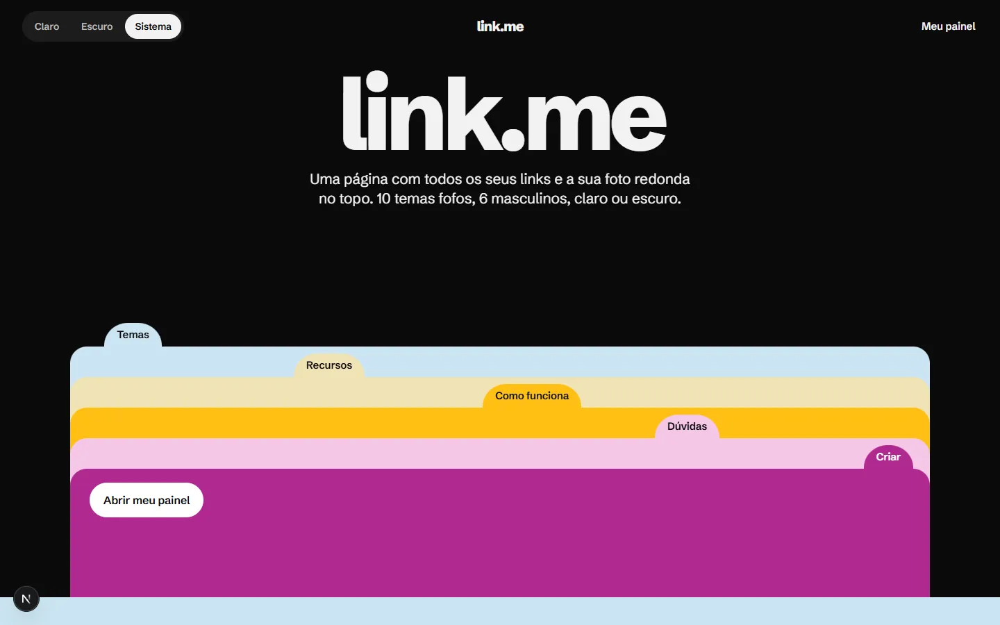
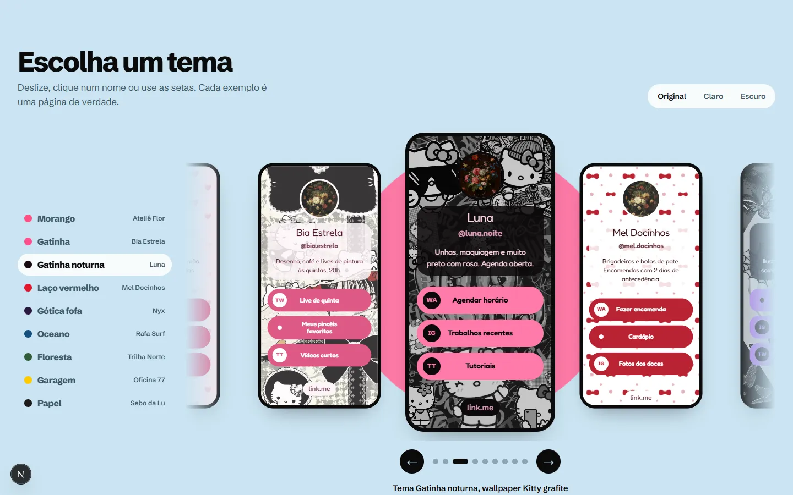
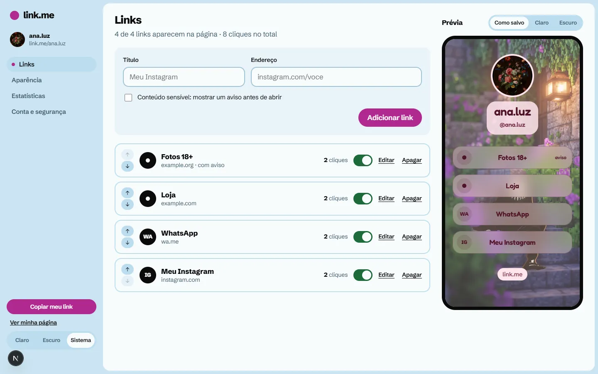
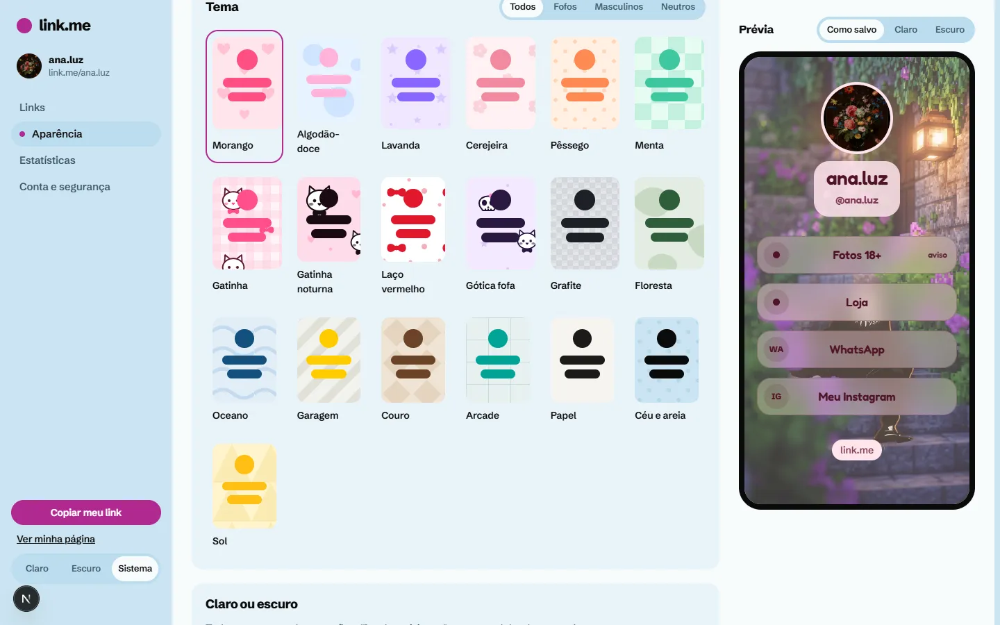
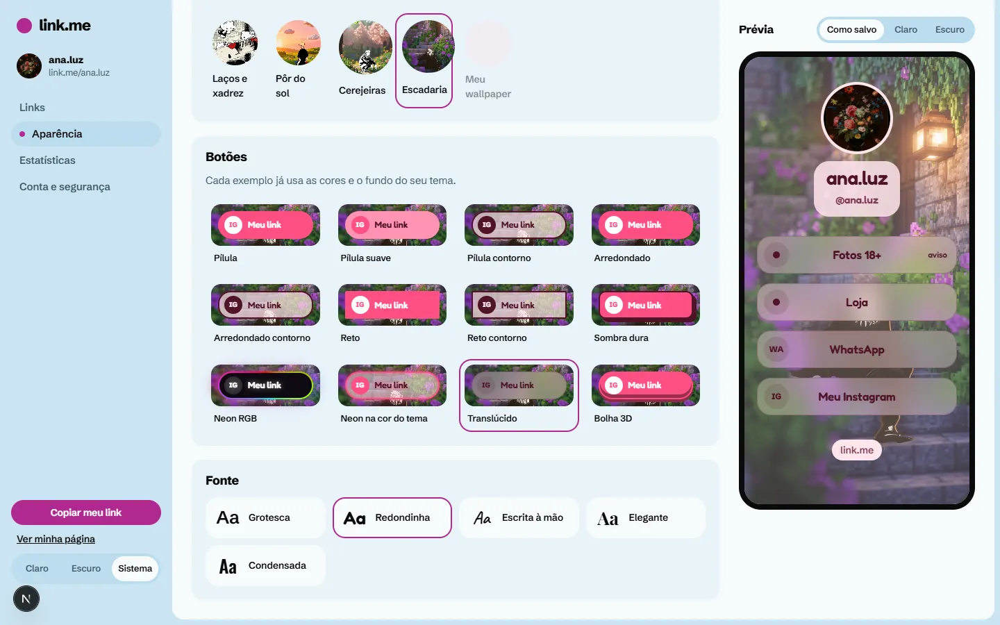
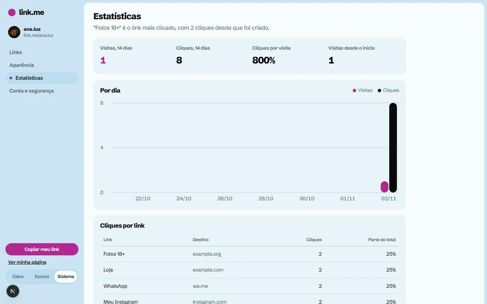
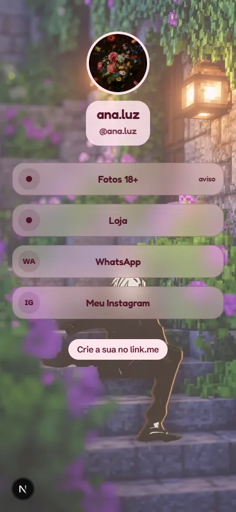
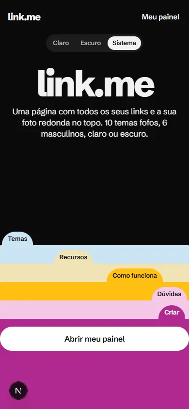

# link.me

**Uma página com todos os seus links e a sua foto redonda no topo.**
Plataforma open source de "link na bio": cada pessoa cria a própria página, escolhe tema fofo,
masculino ou neutro, modo claro ou escuro, wallpaper e estilo de botão, e acompanha os cliques num painel.

[](https://vercel.com/new/clone?repository-url=https%3A%2F%2Fgithub.com%2FRuthraas%2FLink.me&env=DATABASE_URL,DATABASE_AUTH_TOKEN,NEXT_PUBLIC_SITE_URL&envDescription=Banco%20Turso%20(libsql%3A%2F%2F...)%20e%20URL%20do%20site)

<p align="center">
  
  
</p>

## O que tem

**Página pública** (`/seu.endereco`)
- Foto de perfil redonda, nome, bio e links com a sigla da rede (IG, WA, YT, TT, GH…)
- 19 temas: 10 fofos, 6 masculinos e 3 neutros, todos com versão clara e escura
- Modo claro, escuro ou "igual ao visitante" (segue o celular de quem abre)
- 18 wallpapers desenhados em SVG nas cores do tema, 9 wallpapers em imagem e envio do próprio wallpaper
- 12 estilos de botão, incluindo Neon RGB animado, Neon na cor do tema, Translúcido e Bolha 3D
- 5 fontes e aviso antes de abrir link marcado como sensível

**Painel**
- Links: adicionar, editar, esconder, apagar, reordenar (arrastar ou setas) e ver cliques
- Aparência com prévia ao vivo e salvamento automático
- Estatísticas: visitas e cliques por dia (14 dias) e ranking de links
- Conta: trocar senha, sair dos outros aparelhos, excluir conta
- Tema claro, escuro ou do sistema também no painel

<p align="center">
  
  
</p>
<p align="center">
  
  
</p>
<p align="center">
  
  
</p>

## Rodar local

```bash
git clone https://github.com/Ruthraas/Link.me.git
cd Link.me
npm install
cp .env.example .env.local   # DATABASE_URL=file:local.db já funciona
npm run dev                  # http://localhost:3000
```

O banco é criado sozinho na primeira requisição (`src/infra/db.ts`). Não há passo de migração.

## Deploy na Vercel

1. Crie um banco no [Turso](https://turso.tech) (plano grátis) ou pela integração Turso no Vercel Marketplace.
2. Importe o repositório na Vercel (ou use o botão acima) e defina:
   - `DATABASE_URL` = `libsql://<seu-banco>.turso.io` (ou `TURSO_DATABASE_URL`, que a integração cria)
   - `DATABASE_AUTH_TOKEN` (ou `TURSO_AUTH_TOKEN`)
   - `NEXT_PUBLIC_SITE_URL` = a URL pública do site
   - opcional: `GOOGLE_SAFE_BROWSING_KEY` para bloquear links de phishing e malware
3. Deploy. SQLite em arquivo não funciona na Vercel (o disco é temporário), por isso o Turso.
   Sem `DATABASE_URL` o app avisa no log em vez de perder dados em silêncio.

## Arquitetura

Camadas com dependência só para dentro, em estilo procedural: funções puras e funções de caso de uso, sem classes.

```
src/
  core/          domínio puro, sem IO: temas, wallpapers, validação (zod), regras de URL e de endereço
  infra/         detalhes: conexão libSQL, scrypt e tokens, repositórios com SQL parametrizado
  services/      casos de uso: auth, sessão, links, perfil, mídia, estatísticas, rate limit
  app/           rotas Next.js; app/actions/* são controllers finos (FormData -> service -> Result)
  ui/            componentes React; ProfileView desenha a página pública, a prévia e a vitrine
  proxy.ts       CSP com nonce por requisição e barreira rápida do /dashboard
```

Serviços nunca lançam erro para falhas esperadas: retornam `Result` (`ok` / `fail`) e a camada de apresentação decide como mostrar.

**Stack:** Next.js 16 (App Router, Server Actions), React 19, TypeScript, libSQL/Turso, zod, sharp.

## Segurança

- Senhas com scrypt (N=2^15) e sal aleatório, comparação em tempo constante.
- Senhas que já vazaram são recusadas via Have I Been Pwned (k-anonymity: só 5 caracteres do hash saem do servidor).
- Login com mensagem genérica e scrypt mesmo quando o e-mail não existe, para não revelar contas.
  Limite de 5 tentativas por conta e 30 por IP a cada 15 minutos.
- Sessões opacas: token de 256 bits em cookie `__Host-` HttpOnly, Secure e SameSite=Lax; o banco guarda só o SHA-256.
  Trocar a senha invalida as sessões antigas.
- CSRF: Server Actions checam o Origin; formulários só enviam para o próprio site.
- Headers: CSP com nonce e `strict-dynamic`, HSTS, `frame-ancestors 'none'`, nosniff e Permissions-Policy.
- Links: só http(s), e-mail e telefone; bloqueia `javascript:`, `data:`, credenciais na URL e redes privadas.
  Cliques passam por `/go/<id>`, sem open redirect.
- Imagens enviadas são decodificadas e regravadas em WebP pelo sharp, sem EXIF nem GPS; SVG é recusado.

Achou uma falha? Veja [SECURITY.md](SECURITY.md).

## Ideias para as próximas versões

- [ ] Domínio próprio por perfil (`links.seunome.com`)
- [ ] Login com Google e chave de acesso (passkey)
- [ ] Verificação de e-mail e recuperação de senha
- [ ] Ícones das redes em SVG no lugar das siglas
- [ ] Agendar links (aparecer e sumir em datas certas)
- [ ] Bloco de vídeo do YouTube e música do Spotify embutidos
- [ ] QR code da página para imprimir
- [ ] Editor de cor livre (escolher a cor do botão e do fundo)
- [ ] Estatísticas por país e por origem (Instagram, TikTok, WhatsApp)
- [ ] Armazenar imagens no Vercel Blob em vez do banco
- [ ] Testes automatizados (Vitest para `core/` e `services/`, Playwright para os fluxos)

## Licença e créditos

O código está sob a licença [MIT](LICENSE).

**As imagens não entram na licença MIT.**
- Os wallpapers em `public/wallpapers/` (feminino-1 a 6 e masculino-1 a 3) foram escolhidos no Pinterest pelo dono do projeto
  e mostram personagens de terceiros, como Hello Kitty (Sanrio). Os direitos são dos autores originais.
  Confirme o uso antes de lançar em produção, ou troque por imagens próprias.
- As fotos de perfil dos exemplos (`public/samples/`) são obras em domínio público via Wikimedia Commons;
  a lista completa está no rodapé do site e em `src/ui/landing/samples.ts`.
